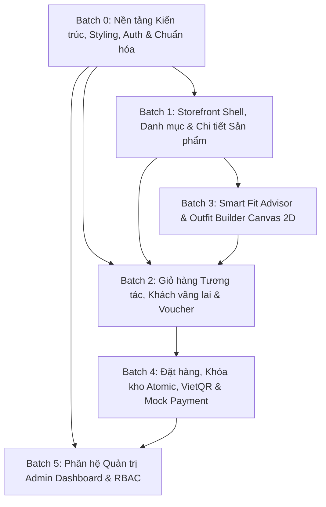

Ran find markdown files
Analyzed README.md:L1-541
Analyzed API_DOCUMENTATION.md:L1-599
Analyzed architecture-guide.md:L1-74
Ran list client directory
Analyzed package.json:L1-39
Analyzed tsconfig.json:L1-34
Ran list all files in client/src
Ran list client/components and client/lib
Ran list client/src/theme
Analyzed axios.api.ts:L1-58
Analyzed layout.tsx:L1-31
Analyzed query-provider.tsx:L1-23
Analyzed page.tsx:L1-8
Analyzed layout.tsx:L1-6
Analyzed page.tsx:L1-209
Analyzed register.api.ts:L1-94
Analyzed register.validation.ts:L1-49
Analyzed use-register.ts:L1-159
Analyzed page.tsx:L1-340
Analyzed AGENTS.md:L1-9
Analyzed README.md:L1-36
Analyzed utils.ts:L1-6
Analyzed components.json:L1-25
Ran find globals.css
Ran find all css files
Analyzed button.tsx:L1-57
Analyzed input.tsx:L1-19
Analyzed label.tsx:L1-19
Ran list server routes
Analyzed index.ts:L1-24
Analyzed auth.routes.ts:L1-14
Analyzed product.routes.ts:L1-10
Analyzed cart.routes.ts:L1-15
Analyzed voucher.routes.ts:L1-8
Analyzed checkout.routes.ts:L1-12
Analyzed payment.routes.ts:L1-11
Analyzed fitAdvisor.routes.ts:L1-8
Analyzed outfit.routes.ts:L1-9
Analyzed admin.routes.ts:L1-26
Analyzing PLAN.md
Analyzed PLAN.md:L1-62
Analyzed threat-model.md:L1-93

Chào bạn, tôi là **Senior Frontend Architect** của dự án **TrendyFit**.

Sau khi nghiên cứu toàn diện và đối chiếu chéo các tài liệu kỹ thuật cốt lõi gồm [`API_DOCUMENTATION.md`](file:///f:/TMDT/docs/API_DOCUMENTATION.md), [`architecture-guide.md`](file:///f:/TMDT/client/.agent/rule/architecture-guide.md), [`README.md`](file:///f:/TMDT/README.md), [`docs/PLAN.md`](file:///f:/TMDT/docs/PLAN.md), [`docs/threat-model.md`](file:///f:/TMDT/docs/threat-model.md), cùng toàn bộ mã nguồn hiện hữu trong thư mục [`client/`](file:///f:/TMDT/client), tôi xin gửi tới bạn bản **Báo cáo Phân tích Kiến trúc Frontend, Đối chiếu API và Kế hoạch Triển khai Chi tiết**.

---

## 1. Điểm chưa rõ & Cần làm rõ theo `architecture-guide.md`

Tuân thủ nghiêm ngặt nguyên tắc của kiến trúc sư: _nêu rõ điểm mâu thuẫn/chưa rõ thay vì tự suy đoán_, tôi phát hiện **06 vấn đề trọng yếu** cần thống nhất trước khi bước vào giai đoạn code:

1. **Thiếu vắng cấu hình Styling Toàn cục (Global CSS & Tailwind v4):**
   - Trong [`components.json`](file:///f:/TMDT/client/components.json), đường dẫn CSS được cấu hình là `"app/globals.css"`, nhưng trong `client/src/app/` hoàn toàn **chưa có file `globals.css`**.
   - [`src/app/layout.tsx`](file:///f:/TMDT/client/src/app/layout.tsx) hiện chỉ nạp font `Geist` mà không import bất kỳ file CSS toàn cục nào. Kết quả là toàn bộ các class tiện ích của Tailwind CSS v4 và các biến màu CSS Variables của Shadcn UI (`--primary`, `--border`, `--destructive`,...) chưa được nạp vào DOM.
   - _Cần làm rõ:_ Khởi tạo file `globals.css` tại `src/app/globals.css` chứa `@import "tailwindcss";` và theme tokens theo chuẩn Shadcn để các UI primitives hoạt động đúng.

2. **Xung đột vị trí thư mục Shared Components giữa `README.md` và `architecture-guide.md`:**
   - [`README.md`](file:///f:/TMDT/README.md#L52) mô tả: `client/src/components/ (ProductCard, SmartFitModal, Canvas...)`.
   - [`architecture-guide.md`](file:///f:/TMDT/client/.agent/rule/architecture-guide.md#L19-L20) lại quy định: thư mục `components/` nằm **ngang hàng với `src`** (tại `client/components/ui/`).
   - _Cần làm rõ:_ Các composite component dùng chung cho Storefront (như `ProductCard`, `Header`, `Footer`, `SmartFitModal`, `OutfitCanvas`) sẽ được đặt tại `client/components/common/` (ngang hàng `src`) hay bên trong `client/src/components/`? _(Khuyến nghị: Đặt tại `client/components/` ngang hàng `src` theo đúng sơ đồ của architecture-guide)._

3. **Cơ chế Quản lý State toàn cục (Global State Management) và vị trí Store:**
   - Cả `README.md` và WBS đồ án đều nêu: sử dụng `Zustand` (`cartStore`, `outfitStore`). Tuy nhiên, `architecture-guide.md` chưa định nghĩa vị trí đặt store và thư viện `zustand` **chưa hề có trong [`package.json`](file:///f:/TMDT/client/package.json)**.
   - _Cần làm rõ:_ Bổ sung cài đặt `zustand` và quy ước vị trí thư mục store tại `client/src/stores/`.

4. **Phân cấp Route Groups trong Next.js App Router:**
   - [`README.md`](file:///f:/TMDT/README.md#L49-L51) định nghĩa phân tách `src/app/(storefront)/` và `src/app/admin/`.
   - [`architecture-guide.md`](file:///f:/TMDT/client/.agent/rule/architecture-guide.md#L27) chỉ mới nêu ví dụ `(auth-layout)/`.
   - _Cần làm rõ:_ Áp dụng Route Group `(storefront)` để chứa chung Header, Navigation, Footer và Giỏ hàng dạng slide-over cho toàn bộ các trang mua sắm.

5. **Hệ thống Thông báo Toàn cục (Toast Notification System):**
   - Tài liệu [`API_DOCUMENTATION.md`](file:///f:/TMDT/docs/API_DOCUMENTATION.md#L556) liên tục hướng dẫn FE bắt lỗi bằng `toast.error`, `toast.warning`, `toast.success`. Tuy nhiên, trong `client/components/ui/` hiện chỉ có `button.tsx`, `input.tsx`, `label.tsx`, chưa có component Toast/Sonner nào.
   - _Cần làm rõ:_ Tích hợp thư viện `sonner` hoặc `toast` của Shadcn UI vào `client/components/ui/` và khai báo `<Toaster />` trong `RootLayout`.

6. **Lỗi lặp cấu trúc Layout kép (Double Layout Wrapping):**
   - [`src/app/(auth-layout)/layout.tsx`](<file:///f:/TMDT/client/src/app/(auth-layout)/layout.tsx>) đã bọc `<main className="auth-shell">{children}</main>`.
   - Tuy nhiên, cả [`login/page.tsx`](<file:///f:/TMDT/client/src/app/(auth-layout)/login/page.tsx#L71>) và [`register/page.tsx`](<file:///f:/TMDT/client/src/app/(auth-layout)/register/page.tsx#L24>) lại tự import và bọc thêm thẻ `<AuthLayout>` một lần nữa trong JSX. Điều này vi phạm ngữ nghĩa HTML5 (lồng 2 thẻ `<main>`).

---

## 2. Phân loại API theo Mục đích Sử dụng

Hệ thống có tổng cộng **31 API endpoints** được định nghĩa trong [`API_DOCUMENTATION.md`](file:///f:/TMDT/docs/API_DOCUMENTATION.md) và triển khai tại [`server/src/routes/`](file:///f:/TMDT/server/src/routes/index.ts). Phân loại chuẩn xác như sau:

### Nhóm A: API Phục vụ Giao diện Người dùng Khách hàng (Storefront & Customer UI - 18 endpoints)

- **Xác thực & Phiên:** `POST /api/auth/register`, `POST /api/auth/login`, `POST /api/auth/logout`, `GET /api/auth/me`.
- **Sản phẩm & Danh mục:** `GET /api/categories`, `GET /api/products`, `GET /api/products/:slug`.
- **Giỏ hàng:** `GET /api/cart`, `POST /api/cart/items`, `PATCH /api/cart/items/:id`, `DELETE /api/cart/items/:id`.
- **Khuyến mãi & Đo size:** `POST /api/vouchers/apply`, `POST /api/fit-advisor/recommend`.
- **Outfit 2D:** `GET /api/outfits`, `GET /api/outfits/slots`.
- **Đặt hàng & Tra cứu:** `POST /api/checkout/lock`, `GET /api/orders`, `GET /api/orders/:code`.
- **Thanh toán Storefront:** `POST /api/payments/create-qr`, `POST /api/payments/mock-simulate` _(chế độ test/demo trên UI)_.

### Nhóm B: API Phục vụ Phân hệ Quản trị (Admin & Staff UI - 11 endpoints)

- **Báo cáo thống kê:** `GET /api/admin/stats` (Quyền: `ADMIN`).
- **Quản lý Đơn hàng:** `GET /api/admin/orders`, `PATCH /api/admin/orders/:id/status` (Quyền: `ADMIN`, `STAFF`).
- **Quản lý Sản phẩm:** `GET /api/admin/products`, `POST /api/admin/products`, `PUT /api/admin/products/:id`, `DELETE /api/admin/products/:id` (Quyền: `ADMIN`).
- **Quản lý Voucher:** `GET /api/admin/vouchers`, `POST /api/admin/vouchers` (Quyền: `ADMIN`).

### Nhóm C: API Dành riêng cho Backend, Webhook & Hạ tầng (2 endpoints)

1. **`POST /api/payments/webhook`**: Cổng PayOS gửi tín hiệu HTTP POST khi khách hàng chuyển khoản thành công.
   - _Đặc điểm:_ Cần xác thực chữ ký HMAC-SHA256, so khớp số tiền và kiểm tra Idempotency. **Frontend tuyệt đối không gọi endpoint này.**
2. **`POST /api/auth/refresh`**: Cấp mới Access Token qua `refreshToken` lưu trong HttpOnly Cookie.
   - _Đặc điểm:_ Do Response Interceptor của Axios (`axios.api.ts`) tự động điều phối ngầm (Silent Refresh) khi gặp HTTP 401. Không gắn trực tiếp vào sự kiện click của người dùng.

---

## 3. Bảng Đối chiếu Chi tiết API với Frontend Hiện tại

|  STT   | Chức năng                             | API Liên quan                        | Trang / Component Sử dụng                                    | Trạng thái Hiện tại                                                                             | Phần còn thiếu                                                                                    | Phụ thuộc cần xử lý trước                 |
| :----: | :------------------------------------ | :----------------------------------- | :----------------------------------------------------------- | :---------------------------------------------------------------------------------------------- | :------------------------------------------------------------------------------------------------ | :---------------------------------------- |
| **1**  | Đăng ký tài khoản                     | `POST /api/auth/register`            | `src/app/(auth-layout)/register/page.tsx`                    | **Đã hoàn thành chuẩn kiến trúc**                                                               | Cần gỡ bỏ bọc `<AuthLayout>` trùng lặp trong `page.tsx`                                           | Đã có Zod, Hook, API, CSS                 |
| **2**  | Đăng nhập tài khoản                   | `POST /api/auth/login`               | `src/app/(auth-layout)/login/page.tsx`                       | **Chưa chuẩn kiến trúc** (viết inline trong page, hardcode "nếp", thiếu phân nhánh `errorCode`) | Tách `login.api.ts`, `use-login.ts`, `login.validation.ts`, `login.css`, hỗ trợ `guestSessionId`  | Cài đặt Toast, chuẩn hóa `axios.api.ts`   |
| **3**  | Cấp mới Access Token                  | `POST /api/auth/refresh`             | `src/api/axios.api.ts` (Response Interceptor)                | **Đã cấu hình cơ bản**                                                                          | Chưa có hàng đợi (Request Queue) chống race condition khi nhiều request 401 đồng thời             | Cấu hình Axios Interceptor nâng cao       |
| **4**  | Đăng xuất                             | `POST /api/auth/logout`              | Header User Menu / User Profile                              | **Chưa triển khai**                                                                             | Component Header, Menu người dùng, Action xóa localStorage và xóa cookie                          | Layout Storefront, Zustand Auth Store     |
| **5**  | Lấy thông tin phiên đăng nhập         | `GET /api/auth/me`                   | Global Auth Provider / Protected Route                       | **Chưa triển khai**                                                                             | Auth Context / Provider để đồng bộ thông tin `user` và `role` khi F5 trang                        | Zustand Auth Store                        |
| **6**  | Danh sách danh mục sản phẩm           | `GET /api/categories`                | Storefront Header Nav, Catalog Sidebar                       | **Chưa triển khai**                                                                             | `categories.api.ts`, Hook TanStack Query, UI Menu/Sidebar                                         | Layout Storefront chung                   |
| **7**  | Danh sách sản phẩm (Lọc & Phân trang) | `GET /api/products`                  | `src/app/(storefront)/products/page.tsx`                     | **Chưa triển khai**                                                                             | Filter Sidebar (giá, màu, size), Search Input `q`, Pagination, ProductCard                        | Base UI `slider`, `checkbox`, `badge`     |
| **8**  | Chi tiết sản phẩm                     | `GET /api/products/:slug`            | `src/app/(storefront)/products/[slug]/page.tsx`              | **Chưa triển khai**                                                                             | Gallery ảnh, Bộ chọn biến thể (Màu/Size/Tồn kho), Bảng Size Chart                                 | UI `radio-group`, `tabs`, Product Hook    |
| **9**  | Thuật toán gợi ý size Smart Fit       | `POST /api/fit-advisor/recommend`    | `components/common/smart-fit-modal.tsx`                      | **Chưa triển khai**                                                                             | Form đo chiều cao, cân nặng, số đo ngực/eo/mông, preference; hiển thị FitScore                    | UI `dialog`, `slider`, Zod schema đo size |
| **10** | Danh sách set phối Lookbook           | `GET /api/outfits`                   | `src/app/(storefront)/outfits/page.tsx`                      | **Chưa triển khai**                                                                             | Lookbook Carousel/Grid, hiển thị chiết khấu combo 15%                                             | Layout Storefront                         |
| **11** | Danh sách món phân theo Slot phối đồ  | `GET /api/outfits/slots`             | `src/app/(storefront)/outfits/builder/page.tsx`              | **Chưa triển khai**                                                                             | Canvas 2D tương tác kéo/chọn món theo slot (TOP, BOTTOM, OUTERWEAR, SHOES), tính tổng tiền combo  | `outfitStore` (Zustand), Canvas 2D        |
| **12** | Lấy thông tin giỏ hàng                | `GET /api/cart`                      | Cart Drawer & `src/app/(storefront)/cart/page.tsx`           | **Chưa triển khai**                                                                             | `cart.api.ts`, Cart Drawer slide-over, Cart Page                                                  | `cartStore` (Zustand), UI `sheet`         |
| **13** | Thêm món vào giỏ                      | `POST /api/cart/items`               | Product Detail & Outfit Builder                              | **Chưa triển khai**                                                                             | Hook `useAddToCart`, bắt lỗi tồn kho                                                              | `cartStore` (Zustand)                     |
| **14** | Cập nhật số lượng món trong giỏ       | `PATCH /api/cart/items/:id`          | Cart Item Component                                          | **Chưa triển khai**                                                                             | Quantity Input (+ / -), kiểm tra số nguyên dương $\ge 1$, tự động xóa nếu về 0                    | Cart Component                            |
| **15** | Xóa món khỏi giỏ                      | `DELETE /api/cart/items/:id`         | Cart Item Component                                          | **Chưa triển khai**                                                                             | Nút xóa món, Dialog xác nhận                                                                      | UI `dialog`                               |
| **16** | Kiểm tra & Áp dụng Voucher            | `POST /api/vouchers/apply`           | Cart Summary & Checkout Page                                 | **Chưa triển khai**                                                                             | Input mã voucher, hiển thị số tiền giảm, bắt lỗi `VOUCHER_EXPIRED`, `VOUCHER_MIN_ORDER_VALUE`     | Form Checkout / Cart                      |
| **17** | Đặt hàng & Khóa giữ kho 10 phút       | `POST /api/checkout/lock`            | `src/app/(storefront)/checkout/page.tsx`                     | **Chưa triển khai**                                                                             | Form thông tin giao hàng, Auth Guard bắt buộc đăng nhập, bắt lỗi 409 (hết hàng) & 429 (quá 2 đơn) | Checkout Validation Schema, Auth Guard    |
| **18** | Danh sách đơn hàng cá nhân            | `GET /api/orders`                    | `src/app/(storefront)/orders/page.tsx`                       | **Chưa triển khai**                                                                             | Bảng lịch sử đơn hàng, Badge trạng thái (`PENDING_PAYMENT`, `PAID`,...)                           | UI `badge`, `table`, Auth Guard           |
| **19** | Chi tiết đơn hàng theo `orderCode`    | `GET /api/orders/:code`              | `src/app/(storefront)/orders/[code]/page.tsx`                | **Chưa triển khai**                                                                             | Màn hình Order Tracking, thông tin giao hàng & sản phẩm                                           | Auth Guard                                |
| **20** | Sinh mã VietQR thanh toán             | `POST /api/payments/create-qr`       | `src/app/(storefront)/checkout/payment/[orderCode]/page.tsx` | **Chưa triển khai**                                                                             | Hiển thị ảnh VietQR động, đồng hồ đếm ngược 10:00 (`lockDurationSeconds: 600`), polling đơn       | Component Timer, QR Modal/Page            |
| **21** | Giả lập thanh toán Demo               | `POST /api/payments/mock-simulate`   | `src/app/(storefront)/checkout/payment/[orderCode]/page.tsx` | **Chưa triển khai**                                                                             | Nút "Thanh toán Demo (Mock)" có điều kiện `isMockMode === true`                                   | Component Payment                         |
| **22** | Tiếp nhận Webhook PayOS               | `POST /api/payments/webhook`         | Backend nội bộ                                               | **Không triển khai trên FE**                                                                    | Không áp dụng cho Frontend                                                                        | Thuộc phạm vi Backend PayOS               |
| **23** | Thống kê Dashboard Quản trị           | `GET /api/admin/stats`               | `src/app/admin/page.tsx`                                     | **Chưa triển khai**                                                                             | Card tổng quan doanh thu, số đơn, số sản phẩm, khách hàng                                         | Admin Layout, RBAC Guard (`ADMIN`)        |
| **24** | Quản lý Đơn hàng Admin/Staff          | `GET /api/admin/orders`              | `src/app/admin/orders/page.tsx`                              | **Chưa triển khai**                                                                             | Bảng danh sách đơn hàng toàn hệ thống, lọc trạng thái                                             | Admin Layout, RBAC (`ADMIN`, `STAFF`)     |
| **25** | Cập nhật Trạng thái Đơn hàng          | `PATCH /api/admin/orders/:id/status` | `src/app/admin/orders/page.tsx`                              | **Chưa triển khai**                                                                             | Dropdown chuyển trạng thái theo đúng State Machine, modal xác nhận hủy đơn hoàn kho               | UI `select`, `dialog`                     |
| **26** | Quản lý Sản phẩm Admin                | `GET /api/admin/products`            | `src/app/admin/products/page.tsx`                            | **Chưa triển khai**                                                                             | Bảng danh sách sản phẩm (kèm ẩn/hiện), bộ lọc danh mục                                            | UI `table`                                |
| **27** | Tạo Sản phẩm mới                      | `POST /api/admin/products`           | `src/app/admin/products/new/page.tsx`                        | **Chưa triển khai**                                                                             | Form tạo sản phẩm, bảng tạo nhiều biến thể SKU (Màu/Size/Kho/Giá)                                 | Form Validation Zod phức tạp              |
| **28** | Cập nhật Sản phẩm                     | `PUT /api/admin/products/:id`        | `src/app/admin/products/[id]/page.tsx`                       | **Chưa triển khai**                                                                             | Form cập nhật thông tin và chỉnh sửa tồn kho biến thể                                             | Form Update                               |
| **29** | Xóa/Ẩn Sản phẩm                       | `DELETE /api/admin/products/:id`     | `src/app/admin/products/page.tsx`                            | **Chưa triển khai**                                                                             | Action chuyển `isActive = false`, Dialog xác nhận                                                 | UI `dialog`                               |
| **30** | Danh sách Voucher Admin               | `GET /api/admin/vouchers`            | `src/app/admin/vouchers/page.tsx`                            | **Chưa triển khai**                                                                             | Bảng danh sách mã giảm giá, theo dõi `usedCount / usageLimit`                                     | UI `table`                                |
| **31** | Tạo Voucher mới Admin                 | `POST /api/admin/vouchers`           | `src/app/admin/vouchers/new/page.tsx`                        | **Chưa triển khai**                                                                             | Form tạo voucher (PERCENT / FIXED, minOrderValue, expiresAt)                                      | Form Validation Zod                       |

---

## 4. Phân tích Rủi ro Kỹ thuật Toàn diện

### 4.1. Rủi ro về Authentication & Session

- **Tấn công XSS đánh cắp Access Token:** Token được lưu trong `localStorage`. Nếu ứng dụng dính lỗi XSS (ví dụ render text unsanitized), kẻ tấn công có thể đánh cắp token. _Khắc phục:_ Đảm bảo toàn bộ input được escape qua React, không dùng `dangerouslySetInnerHTML`.
- **Race Condition khi Token Refresh:** Nếu nhiều request cùng trả về 401 tại một thời điểm, Interceptor trong `axios.api.ts` sẽ bắn đồng thời nhiều request `POST /api/auth/refresh`. Do Backend sử dụng cookie xoay vòng, request đầu tiên đổi token có thể khiến các request tiếp theo bị từ chối và logout người dùng bất thường. _Khắc phục:_ Triển khai hàng đợi xử lý token refresh (Refresh Promise / Subscriber Queue).
- **Lệch trạng thái Auth giữa các Component:** Hiện không có reactive state cho Auth. Khi user đăng nhập hoặc hết hạn phiên, Header và trang hiện tại không tự cập nhật nếu không F5. _Khắc phục:_ Đồng bộ vào `authStore` (Zustand).

### 4.2. Rủi ro về Authorization & RBAC

- **Thiếu Middleware chặn Route phía Client:** Người dùng có thể trực tiếp gõ đường dẫn `/admin` hoặc `/checkout`. Nếu không có Next.js Route Guard hoặc Middleware, giao diện nhạy cảm sẽ bị flash trước khi API trả về 403.
- **Rủi ro IDOR ở phía Client:** Khi gọi chi tiết đơn hàng `GET /api/orders/:code` hoặc tạo mã QR, người dùng có thể đổi mã trên URL. _Khắc phục:_ Bắt chính xác mã HTTP 403 `FORBIDDEN_ACCESS` từ Backend để redirect sang màn hình lỗi 403 Forbidden.

### 4.3. Rủi ro về Dữ liệu API (Data Integrity)

- **Kiểu dữ liệu Tiền tệ Decimal:** Backend trả về các trường `basePrice`, `totalAmount`, `finalAmount` dạng chuỗi (String Decimal từ Prisma). Nếu Frontend tính toán số học trực tiếp bằng `+` hoặc `Number()` mà không validate kỹ sẽ gặp lỗi hiển thị sai hoặc `NaN`.
- **Rủi ro chọn Biến thể hết hàng:** Một sản phẩm có nhiều biến thể màu và size. Nếu FE không disable các nút chọn size/màu có `stockQuantity === 0`, khách hàng sẽ bấm thêm vào giỏ và nhận lỗi khó chịu.

### 4.4. Rủi ro về Giỏ hàng & Cart Merge

- **Thất thoát Giỏ hàng Khách vãng lai:** Nếu `trendyfit_session_id` bị ghi đè hoặc không gửi kèm header `x-session-id`, giỏ hàng khách vãng lai sẽ bị mất.
- **Không truyền `guestSessionId` khi Đăng nhập:** Form đăng nhập phải lấy chính xác `trendyfit_session_id` từ `localStorage` để truyền vào `POST /api/auth/login`. Nếu thiếu, Backend không thể thực thi Cart Merge (cộng dồn số lượng).
- **Thao túng Số lượng Giỏ hàng:** Input số lượng giỏ hàng phải chặn tuyệt đối số âm, số 0 hoặc số thập phân. Nếu số lượng nhập vào $< 1$, cần kích hoạt hộp thoại xác nhận xóa món (`DELETE /api/cart/items/:id`).

### 4.5. Rủi ro về Thanh toán & Khóa giữ kho (10-Minute Lock)

- **Hết hạn Giữ kho 10 phút:** Đơn hàng chỉ được giữ trong 600 giây. Nếu khách hàng treo máy quá 10 phút, Cron Job backend sẽ hủy đơn (`CANCELLED`) và hoàn lại kho. Nếu FE không có đồng hồ đếm ngược và không khóa nút thanh toán, khách hàng có thể chuyển khoản vào một đơn đã bị hủy, dẫn đến tình trạng chuyển sang `PAYMENT_EXPIRED_PENDING_REFUND`.
- **Tranh chấp Hết hàng lúc Checkout (HTTP 409 `INSUFFICIENT_STOCK`):** Khi nhiều người cùng bấm Đặt hàng cho sản phẩm còn 1 cái, người sau sẽ bị từ chối. FE phải bắt đúng mã lỗi này để mở Modal thông báo rõ sản phẩm nào hết hàng và refetch lại giỏ hàng.
- **Spam Giữ kho (HTTP 429 `ORDER_PENDING_LIMIT_REACHED`):** Mỗi tài khoản chỉ được duy trì tối đa 2 đơn `PENDING_PAYMENT`. Khi gặp lỗi này, FE cần mở Dialog điều hướng khách hàng sang trang `/orders` để thanh toán đơn cũ thay vì để họ tiếp tục bấm thử lại.

### 4.6. Rủi ro về Xử lý Lỗi (Error Handling)

- Thiếu cơ chế ánh xạ mã lỗi đồng nhất: Toàn bộ phản hồi lỗi từ Backend đều theo định dạng `{ success: false, errorCode, message, errors }`. Nếu Frontend chỉ hiển thị lỗi chung chung qua `err.message` của Axios, người dùng sẽ không nhận được hướng dẫn xử lý cụ thể (như lỗi voucher hết hạn vs đơn chưa đủ giá trị tối thiểu).

---

## 5. Đề xuất Lộ trình Triển khai thành các Batch Nhỏ (Dependency-First)

Lộ trình được thiết kế theo đúng quan hệ phụ thuộc kỹ thuật nghiêm ngặt:

---

## 6. Kế hoạch Triển khai Cụ thể & Xác định Chính xác Batch Đầu Tiên

### Batch Đầu Tiên Bắt Buộc Phải Thực Hiện: **BATCH 0 - NỀN TẢNG KIẾN TRÚC, STYLING, AUTH VÀ CHUẨN HÓA HẠ TẦNG**

Trước khi phát triển bất kỳ giao diện mua sắm hay quản trị nào, toàn bộ nền móng kiến trúc của Frontend phải được củng cố và đồng bộ tuyệt đối theo `architecture-guide.md`:

#### Các Hạng mục Triển khai Cụ thể của Batch 0:

1. **Khởi tạo Styling & Theme Tokens Toàn cục:**
   - Cài đặt và cấu hình `src/app/globals.css` chứa `@import "tailwindcss";` cùng hệ thống CSS variables (màu sắc, border, radius) theo đúng cấu hình Shadcn trong `components.json`.
   - Nạp `globals.css` vào [`src/app/layout.tsx`](file:///f:/TMDT/client/src/app/layout.tsx).
2. **Bổ sung UI Primitives thiết yếu vào `components/ui/`:**
   - Cài đặt `zustand` vào `package.json`.
   - Thêm component `toast` (Sonner), `dialog`, `badge` phục vụ thông báo lỗi và cảnh báo nghiệp vụ.
   - Bổ sung `<Toaster position="top-right" richColors />` vào `RootLayout`.
3. **Nâng cấp Axios Interceptor & Silent Refresh Queue:**
   - Tối ưu [`src/api/axios.api.ts`](file:///f:/TMDT/client/src/api/axios.api.ts) với cơ chế Refresh Promise Queue nhằm chống race condition khi nhận nhiều lỗi 401 đồng thời.
   - Thống nhất hàm tiện ích `formatCurrencyVND` và helper trích xuất lỗi chuẩn Backend (`getApiErrorMessage`).
4. **Chuẩn hóa Module `login` theo đúng `architecture-guide.md`:**
   - Tạo [`login.api.ts`](<file:///f:/TMDT/client/src/app/(auth-layout)/login/api/login.api.ts>): Định nghĩa kiểu `LoginRequest`, `LoginResponse`, hàm `loginApi` và hook `useLoginMutation` (TanStack Query).
   - Tạo `validation/login.validation.ts`: Schema Zod (email chuẩn, password $\ge 6$).
   - Tạo `hooks/use-login.ts`: Xử lý submit, tự động gửi `guestSessionId`, lưu `accessToken` và `user`, phân nhánh `AUTH_INVALID_CREDENTIALS`.
   - Tạo `style/login.css`: Tách CSS riêng cho module login.
   - Tái cấu trúc `page.tsx`: Loại bỏ chữ "nếp", loại bỏ bọc lặp `<AuthLayout>`, chỉ ráp component UI và hook.
5. **Sửa lỗi Layout kép tại Module `register`:**
   - Gỡ bỏ việc bọc thủ công thẻ `<AuthLayout>` trong return JSX của [`src/app/(auth-layout)/register/page.tsx`](<file:///f:/TMDT/client/src/app/(auth-layout)/register/page.tsx>).
6. **Xây dựng Global Auth Store (`authStore.ts`):**
   - Quản lý trạng thái `user`, `role`, `isAuthenticated`, `isInitialized`.
   - Tích hợp gọi `GET /api/auth/me` để re-hydrate phiên đăng nhập khi F5 trang và `POST /api/auth/logout` để đăng xuất sạch sẽ.

---

### Tóm tắt Kế hoạch các Batch Tiếp theo (Sau khi Batch 0 hoàn tất):

- **Batch 1:** Storefront Layout (Header, Navigation, Footer), Trang chủ, Danh mục (`/products`), Chi tiết sản phẩm (`/products/[slug]`).
- **Batch 2:** Giỏ hàng (`cartStore`), Slide-over Cart Drawer, Trang Giỏ hàng (`/cart`), Cập nhật/Xóa món, Áp dụng Voucher (`/api/vouchers/apply`).
- **Batch 3:** Modal gợi ý size Smart Fit Advisor (`/api/fit-advisor/recommend`) và Module Canvas 2D Outfit Builder (`/outfits`).
- **Batch 4:** Trang Checkout (`/checkout` - `POST /api/checkout/lock`), Trang thanh toán VietQR với đồng hồ đếm ngược 10 phút, Mock Simulate Payment và Lịch sử đơn hàng (`/orders`).
- **Batch 5:** Toàn bộ phân hệ Admin Dashboard (`/admin`, `/admin/orders`, `/admin/products`, `/admin/vouchers`).

Toàn bộ phân tích trên đã sẵn sàng. Khi bạn đồng ý với kế hoạch này, chúng ta sẽ bắt đầu thực thi chính xác **Batch 0**.
